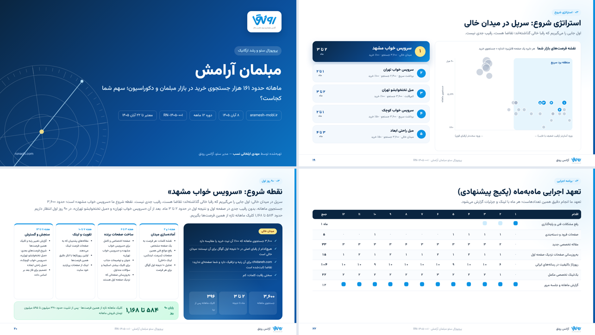

# اسطرلاب (Ostorlab by Ronagh) — پروپوزال‌ساز هوشمند سئو

> **پیش از حرکت، مسیر را بسنج.** اسطرلاب ابزار دریانوردان برای سنجش موقعیت و ترسیم مسیر پیش از سفر بود. در خانواده ابزارهای رونق، قطب‌نما جهت کلمات را نشان می‌دهد، سکان پروژه را ماه‌به‌ماه هدایت می‌کند و **اسطرلاب** پیش از شروع، موقعیت امروز کارفرما، فاصله‌اش با رقبا و مسیر رسیدن را می‌سنجد.

افزونه وردپرسی آژانس رونق برای ساخت پروپوزال سئو در کمتر از یک ساعت: با ۵ تا ۷ کلمه کلیدی کارفرما و ۳ تا ۵ رقیب، اسطرلاب بازار جستجو، رقبا، رپورتاژها و بک‌لینک‌های باکیفیت، وضعیت فنی و (در صورت دسترسی) سرچ کنسول را تحلیل می‌کند، هزینه و نقشه راه ۸ تا ۱۲ ماهه را محاسبه می‌کند و یک **PDF اسلایدی ۱۶:۹** با تم آبی و آسمانی و لوگوی رونق می‌سازد.



نمونه خروجی با داده نمایشی: [docs/sample-proposal-demo.pdf](docs/sample-proposal-demo.pdf)

## نصب

1. `bin/build-zip.sh` را اجرا کنید (یا پوشه `ostorlab` را زیپ کنید) و از «افزونه‌ها › افزودن › بارگذاری» نصب کنید.
2. «اسطرلاب › تنظیمات › اتصال‌ها»: کلید سئو سیگنال (ایمیل:توکن). اگر **سکان** روی همین وردپرس نصب است، کلید سئو سیگنال، هوش مصنوعی (GapGPT) و اتصال گوگل از سکان خوانده می‌شود و لازم نیست دوباره وارد کنید.
3. «آژانس و برند»: لوگو، نام مشاور، تلفن، نمونه‌کارها. «قیمت‌ها»: دستمزد ماهانه و قیمت محتوا/رپورتاژ.

## روند کار

1. **پروپوزال جدید**: نام کارفرما، نوع کسب‌وکار، میانگین ارزش سفارش، دامنه (اختیاری)، دسترسی‌ها (سایت / سرچ کنسول)، ۵–۷ کلمه، ۳–۵ رقیب، طول دوره.
2. **شروع تحلیل**: مرحله‌به‌مرحله با نوار پیشرفت (هر مرحله یک درخواست جدا، بدون خطای timeout). اگر سقف روزانه سئو سیگنال پر شود، تحلیل متوقف و فردا با «ادامه تحلیل» از همان‌جا ادامه می‌یابد. پاسخ‌ها ۲۰ روز کش می‌شوند.
3. **بررسی تب‌ها**: بازار، رقبا، آف‌پیج، تکنیکال (+ اسکریمینگ فراگ)، هزینه‌ها (قابل ویرایش)، متن‌ها (قابل ویرایش).
4. **خروجی PDF**: انتخاب اسلایدها، دانلود PDF، یا لینک وب قابل اشتراک برای کارفرما.

## تحلیل‌ها

| بخش | منبع | خروجی |
|---|---|---|
| بازار جستجو | سئو سیگنال `keyword-research` | هر کلمه = یک خوشه؛ حجم ماهانه، روند ۱۲ ماه، تفکیک نیت (خرید، مقایسه، محلی، عمومی، آموزشی)، **جستجوی آماده خرید**، کلمات پول‌ساز، سؤال‌های مشتری، پیشتازان هر خوشه |
| رقبا | سئو سیگنال `site-analyzer` + نقشه سایت | تعداد صفحات سایت، کلمات و صفحات رتبه‌دار، **نمایش و کلیک ماهانه تخمینی** (رتبه میانگین صفحه × منحنی CTR جهانی)، کلیک خرید، سفارش/سرنخ و **بازه درآمد ماهانه** (نرخ تبدیل × میانگین سبد)، سهم بازار، صفحات پول‌ساز |
| شکاف کلمات | سئو سیگنال `site-compare` (gap) | کلماتی که رقبا دارند و کارفرما ندارد، امتیازدهی با نیت خرید |
| آف‌پیج | سئو سیگنال `reportage-buyer` (امروز) + سمراش Backlinks API (ساختار کامل، با یک تیک فعال می‌شود) | **فقط باکیفیت‌ها شمرده می‌شوند**: رسانه ایرانی، فالو، انکر هدفمند (کلمه بازار، نه «اینجا»/آدرس/برند)، بدون دایرکتوری، کامنت، پروفایل، انجمن، سایت‌واید و وبلاگ رایگان؛ برای دامنه و برای **صفحات پرترافیک/پرفروش**؛ قیمت میانه رپورتاژ رقبا و هزینه ۱۲ ماه‌شان |
| تکنیکال | بررسی سریع داخلی + **اسکریمینگ فراگ** | HTTPS، robots، نقشه سایت، سرعت، عنوان/متا/H1/کنونیکال/اسکیما/alt/محتوای کم؛ با SF: ۴xx/۵xx، ریدایرکت، زنجیره و حلقه ریدایرکت، لینک داخلی شکسته، لینک به ریدایرکت، عنوان/متا/H1 تکراری، عمق، صفحات یتیم، کند، تقریباً تکراری، انکر داخلی بی‌معنی؛ امتیاز ۰ تا ۱۰۰ |
| سرچ کنسول | Search Console API (سرویس اکانت یا اتصال سکان) | کلیک و نمایش ۳ ماه، روند ۱۶ ماه، برندی/غیربرندی، کلمات نزدیک صفحه اول |

### اسکریمینگ فراگ
در تب تکنیکال، اسکریپت آماده همان پروپوزال (ویندوز `.ps1` یا مک/لینوکس `.sh`) را دانلود کنید. اسکریپت برای کارفرما و همه رقبا فهرست صفحات مهم را از نقشه سایت (تا سقف تعیین‌شده، پیش‌فرض ۵۰۰) می‌گیرد، با SEO Spider در حالت list می‌خزد و Internal All، All Inlinks و Redirects را به‌صورت خودکار به اسطرلاب می‌فرستد. حالت `-Mode spider -Config limit.seospiderconfig` هم برای خزش عنکبوتی با محدودیت دلخواه هست. آپلود دستی فایل‌ها هم ممکن است.

### سمراش
ساختار کامل (backlinks_overview، refdomains، backlinks، anchors، pages و لینک‌های ۳ صفحه برتر هر دامنه) آماده است. پس از فعال شدن اکانت: تنظیمات › سمراش › کلید + تیک «فعال» + تست اتصال، سپس «به‌روزرسانی تحلیل».

## استراتژی شروع (نقطه ورود)

هسته «واو» پروپوزال: اسطرلاب از بین همه کلمات بازار، **موضوع‌هایی را که یک صفحه می‌تواند ببرد** پیدا می‌کند («خرید/قیمت/بهترین مبل ال کوچک» = یک موضوع) و هرکدام را امتیاز می‌دهد:

- **تقاضا**: جستجوی ماهانه موضوع
- **پول**: سهم جستجوهای خرید، مقایسه و محلی
- **سهولت**: سختی رقابت کلمات از سئو سیگنال
- **ضعف رقبا**: چند رقیب در ۳ و ۱۰ نتیجه اول هستند (میدان خالی = امتیاز بیشتر)
- **اثبات تقاضا**: رقیب برایش رتبه دارد و کارفرما صفحه ندارد (شکاف کلمات)
- **جایگاه فعلی کارفرما**: اگر رتبه ۴ تا ۲۰ دارد، سریع‌ترین برد است (برداشت سریع)
- کلمات خیلی کلی (خود کلمه اصلی، مثل «مبل راحتی») صفحه دسته‌اند و کندتر؛ موضوع‌های مشخص‌تر اولویت می‌گیرند.

برای هر فرصت زمان تا نتیجه، کلیک و فروش قابل انتظار و دلیل‌های ساده («هیچ رقیبی در صفحه اول نیست»، «شما همین الان رتبه ۱۲ دارید»…) محاسبه می‌شود. ۵ فرصت برتر (اول سریع‌ها) با نام استراتژی («سرپل در میدان خالی»، «برداشت سریع»، «ورود از شکاف رقبا»، «ورود از ضلع کم‌رقابت») در دو اسلاید می‌آید:
1. **نقشه فرصت‌های بازار**: نمودار حبابی (سهولت ورود × جستجو × جستجوی خرید) با «منطقه برد سریع» و فهرست ۵ فرصت.
2. **نقطه شروع و ۹۰ روز اول**: فرصت اول با دلیل‌ها، برنامه هفته‌به‌هفته ۹۰ روز و کلیک قابل انتظار پایان ۹۰ روز.

در تب «استراتژی شروع» می‌توانید فرصت‌ها را سنجاق یا حذف کنید؛ متن استراتژی را هوش مصنوعی می‌نویسد و در تب متن‌ها قابل ویرایش است. نقشه راه، خلاصه اجرایی و صفحه اول پروپوزال هم به همین نقطه شروع اشاره می‌کنند.

## ارائه‌دهنده و برند

در تنظیمات › آژانس و برند: لوگو، نام و شعار آژانس، تلفن، ایمیل، سایت، آدرس، اینستاگرام، لینکدین، آمار اعتبار (مثلاً «۱۲۰+ پروژه»)، مدیر سئو پیش‌فرض (نام، سمت، موبایل، ایمیل، عکس، معرفی کوتاه)، تیم پیش‌فرض، پیشوند شماره پروپوزال و مدت اعتبار. در هر پروپوزال بخش «ارائه‌دهنده» همه این‌ها را بازنویسی می‌کند: تقدیم به (نام تصمیم‌گیر کارفرما)، ارائه‌دهنده، سمت، تماس، شماره پروپوزال، اعتبار و تیم همان پروژه. روی جلد، پاورقی همه اسلایدها، اسلاید «تیم شما» و اسلاید پایانی نمایش داده می‌شود.

## محاسبه هزینه و نقشه راه

- تعدادها از داده می‌آیند و دلیل هرکدام در پروپوزال نوشته می‌شود: صفحات فرود از کلمات خرید بی‌صفحه، مقاله از فاصله صفحات رتبه‌دار با رقبا و سؤال‌های مشتری، به‌روزرسانی از صفحات رتبه ۴ تا ۲۰، رپورتاژ از سرعت رپورتاژ رقبا و فاصله، بک‌لینک مکمل از فاصله دامنه‌های باکیفیت.
- سه پکیج (پایه / پیشنهادی / رشد سریع)، تفکیک **دستمزد تیم سئو** از **بودجه محتوا و آف‌پیج با پرداخت مستقیم کارفرما**؛ همه اعداد در تب هزینه‌ها قابل تغییر است.
- نقشه راه ۵ مرحله‌ای روی ۸ تا ۱۲ ماه با تاریخ شمسی، تحویل‌های هر مرحله و نتیجه واقع‌بینانه (منحنی S، سه سناریو، بر اساس سهمی که رقبا امروز از همین بازار دارند). تعهد «انجام کار» به جای «تضمین رتبه».

## متن‌ها و هوش مصنوعی
خلاصه اجرایی، تیتر جلد، توضیح هر بخش، SWOT و قدم‌های بعدی با همان API سکان (GapGPT سازگار با OpenAI یا Anthropic) به فارسی ساده نوشته می‌شود؛ بدون اتصال هوش مصنوعی هم متن آماده با عددهای تحلیل ساخته می‌شود. همه متن‌ها قبل از خروجی قابل ویرایش‌اند.

## PDF
- پیش‌فرض: پنجره چاپ مرورگر (Save as PDF)؛ اندازه صفحه ۱۲۸۰×۷۲۰ (اسلاید پاورپوینت ۱۶:۹) و پس‌زمینه‌ها خودکار.
- اختیاری: سرویس [Gotenberg](https://gotenberg.dev) (`docker run -p 3000:3000 gotenberg/gotenberg:8`) برای دانلود مستقیم PDF از سرور.
- فونت: وزیرمتن (OFL) داخل افزونه؛ رنگ‌های تم در تنظیمات.

## ساختار کد

```
ostorlab/
  ostorlab.php                 بارگذاری
  inc/core/                  تنظیمات (با fallback به سکان)، شبکه/پروکسی، ذخیره پروپوزال (post type)
  inc/connectors/            seosignal, semrush, google (GSC), llm, site (بررسی سریع), screaming-frog
  inc/engine/                keywords, competitors, strategy, offpage, technical, forecast, budget, roadmap, writer, runner, charts (SVG), deck, pdf
  inc/rest.php               REST ایجنت اسکریمینگ فراگ + نسخه وب
  inc/admin/                 منو و اکشن‌ها
  templates/admin/           رابط مدیریت
  templates/deck/deck.php    اسلایدها
  assets/                    css, js, فونت، لوگوی رونق
```

نیازمندی: وردپرس ۶.۴+، PHP 8.0+.
